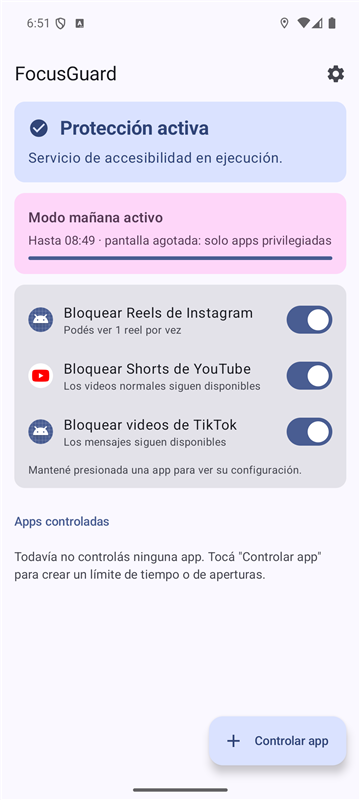
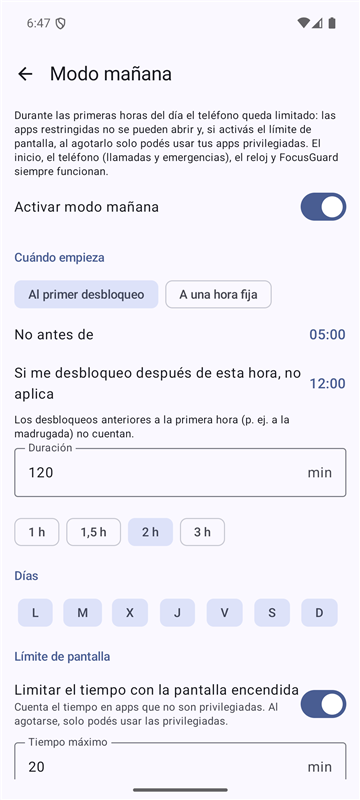

# FocusGuard

App Android personal para reducir distracciones: bloquea los videos cortos (Reels, Shorts, TikTok)
**sin bloquear el resto de esas apps**, limita el tiempo y las aperturas de las apps que elijas y
restringe el teléfono durante las primeras horas del día. Funciona 100 % en el teléfono: sin
Internet, cuentas, publicidad ni analítica.


<p align="center">
  
  &nbsp;&nbsp;
  
</p>

## Funciones

- **Videos cortos:** te saca de Instagram Reels, YouTube Shorts y los videos de TikTok, y deja
  usar el feed, los mensajes, los perfiles y los videos normales.
  - Podés permitir **N videos por vez**. Ejemplo con 1: ves el reel que te mandó un amigo y, si
    deslizás al siguiente, te saca. Cada vez que entrás al visor la cuenta empieza de cero.
  - Antes de mostrar la pantalla de bloqueo, sale del visor, así la app no queda en Reels.
- **Límite de tiempo por app:** diario, semanal o cada N horas, con hora de reinicio configurable.
  Cuenta solo el tiempo real con la app en pantalla.
- **Límite de aperturas por app:** por ejemplo 3 aperturas cada 60 minutos, en ventana móvil o en
  bloques fijos. Los intentos bloqueados no consumen aperturas.
- **Modo mañana:** desde el primer desbloqueo del día (o a una hora fija) y durante el tiempo que
  elijas:
  - las apps restringidas no se pueden abrir;
  - hay un tope de tiempo con la pantalla encendida;
  - las apps privilegiadas siempre funcionan y no cuentan para el tope;
  - el inicio, el teléfono (llamadas y emergencias), el reloj y FocusGuard nunca se bloquean.
- **Panel** con el tiempo y las aperturas restantes y el próximo reinicio. Mantener presionada una
  plataforma abre su configuración.
- **Ajustes por secciones**, tema claro, oscuro o según el sistema, y pantalla de **Diagnóstico**
  para ajustar la detección si una app cambia su interfaz.

## Estado

| Función | Estado |
|---|---|
| Límites de tiempo y de aperturas, períodos, recuperación tras reinicio | Probado en emulador Android 16 y con tests unitarios. |
| Modo mañana | Probado en emulador y con tests unitarios. |
| Instalador `instalar.bat`, reactivación automática del servicio, tema | Probado en emulador. |
| Detección de Reels / Shorts / TikTok | Probada en emulador con apps de prueba que imitan la estructura de los visores. **Todavía no se probó con las apps reales**: sus interfaces cambian seguido. |
| TikTok | Experimental: se reconoce por estructura, porque la app no expone identificadores estables. |

Detalle de las pruebas en [docs/RESULTADOS_EMULADOR.md](docs/RESULTADOS_EMULADOR.md).

## Instalación

Requisito: Android 8.0 o superior.

### Con `instalar.bat` (recomendado, Windows)

Instala la app y deja todo configurado: activa el servicio de accesibilidad, excluye la app del
ahorro de batería y le da permiso para reactivar su servicio si Android lo apaga.

1. Descargá `FocusGuard-1.3.0.apk` desde [Releases](../../releases) y guardalo en la carpeta `dist/`
   del repositorio.
2. En el celular, activá **Opciones de desarrollador → Depuración por USB** y conectalo a la PC.
3. Hacé doble clic en [`instalar.bat`](instalar.bat) y aceptá el aviso de depuración en el celular.

### Manual

Instalá el APK en el celular y activá el servicio en **Ajustes → Accesibilidad → FocusGuard**. En
Android 13 o superior quizás tengas que habilitar antes **Info de la app → ⋮ → Permitir ajustes
restringidos**.

Guía completa: [docs/INSTALACION_Y_PERMISOS.md](docs/INSTALACION_Y_PERMISOS.md).

## Cómo funciona

FocusGuard usa un único acceso especial: el **servicio de accesibilidad** de Android. Con él:

- sabe qué app está en pantalla, para contar el tiempo y las aperturas;
- reconoce los visores de videos cortos por su estructura: identificadores de vista, tamaño y
  orientación de las listas, y pestañas seleccionadas;
- ejecuta **Atrás** o **Inicio** para salir.

No usa acceso a datos de uso, notificaciones, alarmas exactas, superposición sobre otras apps ni
Internet. FocusGuard **no es una herramienta de accesibilidad para personas con discapacidad**, y
así lo declara.

### Privacidad

- No guarda textos de pantalla, mensajes, contraseñas ni capturas. Los textos se comparan en memoria
  con palabras clave y se descartan.
- Solo guarda tus reglas, tus ajustes y, para las apps que controlás, los horarios de uso y de
  apertura (15 días como máximo).
- Las copias de seguridad en la nube están desactivadas.

### Arquitectura

```
app/src/main/java/com/personal/focusguard/
├── domain/      Lógica pura y testeable: períodos (con horario de verano y zonas horarias),
│                límites, historial, seguimiento de la app en primer plano y modo mañana
├── detection/   Reglas y puntaje de los visores de videos cortos
│                (DetectionRules.kt es el único archivo a tocar si cambia una app)
├── data/        Room (reglas e historial) y DataStore (ajustes)
├── service/     Servicio de accesibilidad, filtro de primer plano, bloqueo y reactivación
└── ui/          Jetpack Compose + Material 3 (MVVM)
```

Decisiones principales:

- **Sin alarmas para reiniciar contadores.** Cada período se calcula a partir de la hora actual, así
  que se corrige solo tras reinicios y cambios de hora o de zona horaria.
- **El tiempo se mide con el reloj monotónico** y se suma como unión de intervalos: un cambio de
  hora no genera tiempo negativo ni duplicado.
- **La detección combina varias señales.** Una palabra suelta como "Reels" o "Shorts" nunca alcanza
  para bloquear.

## Compilar

Requisitos: JDK 17 o superior y Android SDK con la plataforma 37. Android Studio los instala solo.

```bash
./gradlew assembleRelease      # APK optimizado en app/build/outputs/apk/release/
./gradlew testDebugUnitTest    # 80 tests unitarios
```

El build `release` se firma con la clave de depuración local para poder instalarlo directamente.

Apps de prueba para el emulador, que imitan la estructura de los visores (instalarlas solo en un
emulador):

```bash
./gradlew -PwithFixtures :fixtures:fakeapps:assembleDebug
```

## Documentación

| Documento | Contenido |
|---|---|
| [INSTALACION_Y_PERMISOS.md](docs/INSTALACION_Y_PERMISOS.md) | Instalación paso a paso, permisos y batería por fabricante |
| [PRUEBAS_MANUALES.md](docs/PRUEBAS_MANUALES.md) | Lista de verificación en un teléfono real |
| [LIMITACIONES_Y_PROBLEMAS.md](docs/LIMITACIONES_Y_PROBLEMAS.md) | Limitaciones conocidas y solución de problemas |
| [RESULTADOS_EMULADOR.md](docs/RESULTADOS_EMULADOR.md) | Qué se probó y con qué resultado |
| [PUBLICACION_Y_IOS.md](docs/PUBLICACION_Y_IOS.md) | Qué haría falta para Google Play y qué es posible en iOS |

## Limitaciones

- Android no permite que una app impida del todo el uso de otra: FocusGuard reacciona en cuanto la
  app aparece en pantalla.
- Todo depende del servicio de accesibilidad: si se desactiva, no hay bloqueos.
- Instagram, YouTube y TikTok cambian sus interfaces sin aviso. Si la detección deja de funcionar,
  la pantalla de Diagnóstico muestra qué ajustar.
- iOS no permite este tipo de bloqueo dentro de otras apps (ver [PUBLICACION_Y_IOS.md](docs/PUBLICACION_Y_IOS.md)).

## Aviso

Proyecto personal, sin relación con Instagram, YouTube, TikTok ni sus empresas. Los nombres se usan
solo para describir con qué apps interactúa FocusGuard.

## Licencia

[MIT](LICENSE) © 2026 Bautista Suarez Vivas.
